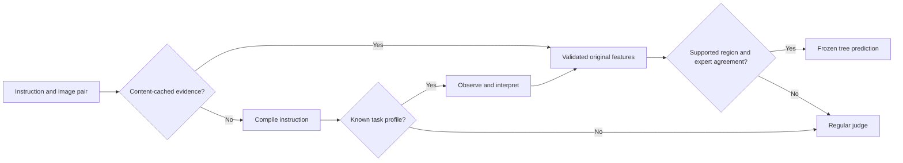

# Evidence coverage that preserves local trained accuracy

The subsequent [v23 counterexample calibration](calitree_counterexample_coverage.md)
rejects all 22 errors reviewed below while retaining local accuracy and all 38
correct transfer acceptances. Those outcomes are now calibration data; the
original v22 results on this page remain unchanged.

The completed v20–v22 path preserves all **144/144 local answers**, including all
twelve original child batches at 12/12. All 144 are now served by frozen experts;
no local case needs a regular-judge fallback. The raw-input verification passes
instructions and image paths with renamed case IDs and no supplied labels,
programs, features or group memberships. Content-cached upstream evidence supplies
the original trained measurements. No new model calls were made.

This replaces the failed v19 reference-only approach for this opt-in research
path. It does not replace the regular judge globally. Unfamiliar inputs can still
be incorrectly accepted; transfer results below quantify that limitation.

## What changed

1. **Preserve the trained prediction.** A covered case executes the original
   expert tree. No LLM is asked to reinterpret its path or generate another label.
   Each emitted prediction is checked against that expert's unchanged runtime.
2. **Learn evidence-based applicability.** The selector learns short conjunctions
   that separate correct from incorrect expert predictions on the local training
   pool. Each accepted region has at least two distinct supporting sources and
   instructions and no local counterexamples. It receives no labels or source
   memberships during inference.
3. **Preserve semantic support.** Additional conditions retain the coarse semantic
   predicates that were constant across a region's supporting examples. These
   conditions can only reject an acceptance; they do not resolve conflicting
   experts by selecting whichever answer is convenient.
4. **Reuse retained children.** If the selected forest leaves a local gap, the
   builder searches the already learned hierarchy for an additional supported
   region. This adds one region in split 2, supported by two sources and two
   batches, and covers the remaining local case. No expert tree is refitted.
5. **Stabilize known inputs.** A content-addressed cache stores compiler programs,
   observations and semantic interpretations. Keys include the instruction,
   ordered source/edited image content, model identity and upstream prompt
   contract. It stores no human labels or final verdicts. A changed input or
   extraction identity cannot reuse the slot, and a different draw cannot
   overwrite trained evidence silently.

The selector uses the original reusable evidence predicates plus declared task
features. Two new flags recognize an explicit leading increase/enlarge/expand
or reduce/decrease/shrink directive in the compiler's authorized-change text.
They are conservative syntactic flags, not unrestricted natural-language
inference. Object names, example IDs, source hashes and arbitrary instruction
substring matches are not routing predicates. These additional task features
distinguish the previously identical evidence records for N003 and N011; the old
feature-only identifiability bound is not being claimed to disappear unchanged.

## Runtime behavior



Missing or invalid evidence, unseen task profiles, lack of a supported region,
semantic novelty and disagreement between supported experts cause fallback.
Fallback receives the original regular prompt and image inputs without tree
references. Compiled programs, observations and interpretations remain bound to
the instruction and exact image pair.

```python
from critical.core.calibration.evidence_support_v21 import SupportedCoverageGate
from critical.core.optimization.prompt.calitree.bound_evidence_cache import (
    BoundEvidenceCache, CachedEvidenceCoveredJudge,
)

gate = SupportedCoverageGate(saved_gate)
cache = BoundEvidenceCache(model_identity, artifact=saved_evidence_cache)
judge = CachedEvidenceCoveredJudge(
    calls, gate, cache, identity=model_identity,
)
result = judge.judge(instruction, evidence, case_id=request_id)
```

`calls` is the existing explicitly budgeted durable-call interface. For a cached,
covered input, there are zero model calls. A fresh supported input normally
needs compilation, observation and interpretation; the compiler can make its
existing single bounded repair call. Uncovered evidence then needs a regular
judgment. This approach prioritizes fidelity to trained evidence over the v19
single-visual-call shortcut. The cache stabilizes known inputs; fresh-extraction
stability on unknown inputs is not established by the local replay.

## Verified local result

| Split | Previous reference-guided judge | New covered tree system | Accepted tree outputs correct | Child batches preserved |
|---|---:|---:|---:|---:|
| 1 | 33/48 | 48/48 | 48/48 | 4/4 |
| 2 | 31/48 | 48/48 | 48/48 | 4/4 |
| 3 | 36/48 | 48/48 | 48/48 | 4/4 |

The reference-guided column is the completed v19 paired experiment. This changes
both selection and final decision execution, so the gain is not attributed to
the gate alone. Two offline controls isolate parts of the change: task-only
selection with deterministic expert execution gives 103/144; additionally
requiring a matching v19 rule also gives 103/144, with only 23 accepted cases.
The final gate accepts all 144 locally and every selected expert is correct.

These are training measurements. The learned applicability regions are supervised
on each gate's original 48 rows, and the evidence cache contains the same upstream
measurements used for fitting. This is the intended local-preservation test,
not a claim of fresh generalization. There are 99 distinct cases and 98 source
groups across the overlapping splits.

The final gates use 14, 13 and 6 supported regions over 4, 4 and 2 frozen experts.
They contain 92 extra guard literals in total, plus 1,114 coarse semantic-support
conditions shared across the regions. These are local Boolean computations, not
additional LLM calls. Search is bounded at six guard literals, 3,000 states per
witness pair and 256 regions. An exploratory eight-literal search did not cover
the final gap; retaining a supported original child did. No new rule verdict was
invented to force completion.

## Coverage accuracy outside the fitting sources

Each frozen gate was also applied to 50 other historical training-pool cases,
excluding all of its fitting source groups. These give 150 correlated transfer
slots. Semantic-support variants were screened on this diagnostic; the results
are exploratory development evidence, not untouched validation.

| Method | Accepted cases | Correct accepted predictions | Accepted-prediction precision | Full system correct |
|---|---:|---:|---:|---:|
| Task-only gate + deterministic selected tree | 55/150 | 22 | 40.0% | 90/150 |
| Initial evidence guards | 69/150 | 40 | 58.0% | 100/150 |
| Final supported evidence gate | 60/150 | 38 | 63.3% | 104/150 |
| Regular judge on every case | — | — | — | 100/150 |

Final system scores are 37/50, 37/50 and 30/50, versus regular-judge scores of
33/50, 38/50 and 29/50. Thus one transfer split still regresses. The gate wrongly
accepts 22 cases and defers on 76 cases for which some expert could have been
correct. It preserves 44 expert-conflict deferrals. These are meaningful remaining
limitations: passing a learned guard is not proof of correctness for a new case.
The implementation remains opt-in, with explicit fallback and trace information.

## Verification and artifacts

- `logs/exps/261019-complete-evidence-coverage-v22`: final gates, per-case routes,
  original-child comparisons, transfer diagnostic and independent audit.
- `logs/exps/261019-raw-complete-coverage-v22`: content-bound caches and raw-input
  replay; all 144 inputs reach correct tree outputs with renamed case IDs,
  zero regular fallbacks and zero new model calls.
- `logs/exps/261019-evidence-coverage-v20` and
  `logs/exps/261019-evidence-support-v21`: preserved intermediate experiments.

The independent final audit reproduces all three gate searches and completion,
checks 33 supported regions and 1,114 semantic conditions, validates 294 bound
inputs, replays all 144 local and 150 transfer predictions, and verifies the 90
exact regular fallback responses in the transfer set. All twelve original child
batches retain 12/12. Unit/regression tests cover missing evidence, unknown tasks,
local counterexamples, unseparable conflicts, search limits, disagreement,
renaming invariance, image binding, raw cache identity and retained-child completion.

```bash
PYTHONPATH=. /path/to/python -m run.verify_calitree_complete_coverage \
  --output-dir logs/exps/261019-complete-evidence-coverage-v22
PYTHONPATH=. /path/to/python -m pytest \
  tests/unit/calitree/test_evidence_coverage_v20.py \
  tests/unit/calitree/test_evidence_support_v21.py \
  tests/unit/calitree/test_complete_evidence_coverage.py \
  tests/unit/calitree/test_bound_input_cache.py -q
```

See [the compact results](experiments/calitree_evidence_coverage_v22.json) and
[portable selector artifacts](../examples/calitree_evidence_coverage_v22/README.md).
Original source-workspace experiments, v19 paid results, trained trees and human
references remain unchanged. No reserved final cases were used.
