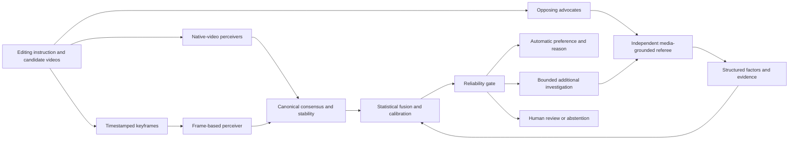

# CritiCal: Calibrating Multimodal Judges for AI-Assisted Video Editing Evaluation

**Technical invention disclosure and example claims**  
**Draft date:** November 5, 2026

## ABSTRACT

Delegating video-editing quality assessment from human expert evaluators to multimodal language models offers substantial advantages in scalability and response latency. However, a persistent calibration gap remains between model judgments and human preferences, particularly when judges misperceive visual evidence, disagree across evaluation criteria, or change decisions when candidate order is reversed. We introduce CritiCal, an evidence-grounded calibration framework that combines diverse multimodal perceivers, adversarial feature discovery, and statistical preference calibration. Native-video and frame-based judges evaluate candidate edits in counterbalanced orders. Opposing advocate agents and an independent media-grounded referee identify contested factors, which are disti@lled into reusable feature categories while preserving their evidence and uncertainty. A fitted calibration model combines these measurements with raw judgments to estimate human-aligned preference probabilities. A reliability gate then routes the comparison to automatic decision, bounded additional investigation, or human review. The framework supports interpretable calibration without retraining the underlying multimodal models and separates supervised calibration from label-free inference.

## 1 INTRODUCTION

Multimodal language models are increasingly used as automated judges in content creation and quality-control pipelines. In AI-assisted video editing, an editing system receives source assets and a user instruction and produces one or more edited videos. A judge assesses whether the outputs satisfy the instruction, preserve relevant content, and form a coherent audiovisual experience. By replacing or augmenting repeated human review, model-based judges can support scalable comparison of editing systems and timely feedback during content production.

Despite these advantages, a model's fluent explanation does not establish that its judgment agrees with human evaluators. A judge may reward visual polish while overlooking a missing required scene, mistake a deliberate transition for an editing defect, or prefer literal text overlays that are unsupported by the underlying footage. Its decision may also change when the same candidates are presented in the opposite order. Such discrepancies make a single raw preference probability an incomplete basis for automated quality control.

Prior approaches address this problem through model training, prompt optimization, fixed-rubric scoring, or post-hoc calibration. These methods provide useful controls, but correcting a judge's numeric output cannot by itself supply evidence that the judge failed to perceive. Similarly, asking one judge to reconsider its own explanation may reproduce its original error. Reliable calibration therefore requires both improved measurements and an explicit mechanism for deciding when those measurements are sufficient.

In this disclosure, we treat the interaction between perception, contested editing criteria, and decision reliability as the central control surface for calibrating video judges. CritiCal combines complementary media representations with structured adversarial analysis, learns how their measurements relate to human preferences, and preserves the option to defer uncertain comparisons.

### 1.1 Technical problem

The technical problem is to produce a reproducible and inspectable preference decision from heterogeneous, potentially inconsistent multimodal judgments. Three sources of error are addressed jointly: incomplete perception of the edited media; disagreement about which observed editing factors are decisive; and uncertainty about whether the resulting preference is reliable enough for automatic use.

A useful system must distinguish a candidate's canonical identity from its displayed position, distinguish missing evidence from evidence of poor quality, and distinguish a model's persuasive argument from a verified observation. It must also prevent a held-out human preference from entering the requests used to generate that comparison's measurements.

### 1.2 Summary of the disclosed system

CritiCal receives an editing instruction and two candidate videos, optionally accompanied by their source assets. It generates multiple observations using native-video and frame-based perceivers, canonicalizes their counterbalanced judgments, and records agreement and instability. An adversarial analysis stage produces candidate-specific claims, checks them against the media, and expresses their implications as structured factors. A statistical fusion stage combines available signals into a calibrated preference probability. A reliability gate determines whether to accept the preference, acquire bounded additional evidence, or refer the comparison for human review.

The disclosed combination links four operations: diverse observation of the same edit; evidence-grounded discovery of disputed evaluation factors; learned fusion of those factors with judge measurements; and reliability-based control of the resulting decision. Individual stages may be disabled or replaced without requiring changes to the underlying multimodal model weights.

## 2 RELATED WORK

### 2.1 VLM/LLM judges and score calibration

A growing body of work uses language and vision-language models to generate quality scores and explanations, then learns a mapping from their outputs to human assessments. *Quantitative LLM Judges* develops post-hoc quantitative models for absolute and relative human feedback [1]. CritiCal shares the objective of learning from limited human supervision. Its disclosed system additionally acquires complementary media observations, exposes order instability, and incorporates structured evidence and reliability signals into preference estimation and routing.

### 2.2 Training evaluator models with rubric conditioning

*Prometheus-Vision* trains an evaluator to follow user-defined scoring criteria using a multimodal feedback dataset [2]. CritiCal operates at a different system boundary: existing evaluator models provide measurements, while separately fitted calibration and routing components adapt their use. Training a new multimodal evaluator is therefore optional rather than a prerequisite for implementing the disclosed pipeline.

### 2.3 Multi-criteria, bottom-up evaluation

*HarmonicEval* aggregates criterion-level assessments into an overall evaluation [3]. CritiCal likewise retains criterion-level information, but adds disputed factors discovered from opposing arguments and independently checked media evidence. It also records whether a measurement is applicable and available, allowing uncertainty to affect routing rather than forcing every comparison into a complete fixed score vector.

### 2.4 Automatic prompt optimization and hierarchical calibration

TextGrad optimizes text components using language-model feedback [4], while GEPA searches over text candidates through reflective evolution [5]. The supplied CaliTree writing sample constructs increasingly general judge prompts by optimizing leaves and merging compatible instructions [S2]. These approaches change the instructions supplied to a judge. The principal CritiCal embodiment instead learns how to interpret and combine measurements from multiple perceivers and adversarial analysis. Prompt optimization and hierarchical prompt reuse remain compatible extensions, but are not required for its pairwise calibration mechanism.

## 3 METHOD

CritiCal consists of three principal stages: diverse-perceiver measurement, adversarial feature discovery, and calibrated decision routing. Each stage converts a less structured input into a more explicit representation while maintaining the separation between media observations and human calibration targets.

Figure 1 illustrates the computational flow. The direct measurement path remains available when debate is disabled, unavailable, or rejected by a validation guard.

**Figure 1.** CritiCal system overview, adapted from the exit talk's perceiver, debate-and-grounding, and calibrator modules [S1, slide 9]. Additional investigation is bounded; unresolved comparisons can remain deferred.

### 3.1 Pair construction and canonical identity

Let an evaluation instance be

$$
x_i=(u_i,V_{i,A},V_{i,B},S_{i,A},S_{i,B}),
\tag{1}
$$

where $u_i$ is the editing instruction, $V_{i,A}$ and $V_{i,B}$ are candidate edits, and $S_{i,A}$ and $S_{i,B}$ are optional source assets. Canonical identities $A$ and $B$ are independent of the order in which the candidates are displayed.

During calibration, a human target $y_i\in[0,1]$ represents the fraction of available votes favoring canonical candidate $A$, or another declared pairwise target derived from human annotations. Vote counts and grouping identifiers remain in the fitting and evaluation layer. Model-facing requests contain the instruction and permitted media, without human targets, annotator identities, or dataset identifiers that could reveal the answer.

Comparisons sharing source content or an instruction group are kept together during grouped evaluation. This prevents repeated views of substantially the same task from appearing on both sides of a reported training/validation split.

### 3.2 Diverse-perceivers calibration

#### 3.2.1 Complementary media representations

The perceiver pool includes at least two complementary configurations. A native-video perceiver receives the edited videos and can assess temporal progression and available audio. A frame-based perceiver receives ordered, timestamped keyframes or contact sheets and can inspect visible content, text, and composition using a different representation. Additional perceivers may differ in model family, sampling policy, or rubric.

The purpose of diversity is to expose observations and errors that a single configuration may miss. Diversity does not imply statistical independence, and its usefulness is measured against the strongest available single-perceiver baseline.

The frame-based implementation explicitly marks audio editing quality as unavailable. Likewise, a source-free comparison cannot establish source preservation. These restrictions propagate as applicability or missingness information rather than fabricated measurements [S3].

#### 3.2.2 Counterbalanced judging and stability

For perceiver $j$, let $p^{AB}_{ij}$ be its probability that the displayed-left candidate is better when canonical $A$ appears first. Let $p^{BA}_{ij}$ be the corresponding probability when canonical $B$ appears first. The canonical swap-averaged preference and order-instability measure are

$$
\bar p_{ij}=\frac{p^{AB}_{ij}+(1-p^{BA}_{ij})}{2},
\qquad
\iota_{ij}=\left|p^{AB}_{ij}-(1-p^{BA}_{ij})\right|.
\tag{2}
$$

This operation remaps displayed positions to a common candidate identity. Averaging can reduce position effects; retaining $\iota_{ij}$ exposes the inconsistency that the average alone would conceal. A judge that consistently selects the first displayed candidate can have $\bar p_{ij}=0.5$ and high instability, which should not be confused with two stable judgments expressing genuine indifference.

#### 3.2.3 Structured criterion measurements

Each applicable perceiver returns candidate-level criterion measurements, evidence, a direct preference probability, and a concise rationale. A reference registry contains instruction alignment, temporal consistency, visual quality, narrative coherence, and audio editing quality. Other deployments may use a compatible domain-specific registry.

For criterion $k$, the system forms a signed candidate difference $\Delta s_{ijk}=s_{ijA,k}-s_{ijB,k}$ after canonical remapping and normalization. The output also retains cross-order spread, missing criteria, and cross-perceiver disagreement. A criterion name alone is insufficient: the record identifies the media and observation supporting the value.

### 3.3 Adversarial debate and feature discovery

#### 3.3.1 Opposing arguments

Two advocate agents inspect the instruction and permitted media. One advocates for canonical $A$ and the other for canonical $B$. Each produces its strongest supported arguments while conceding observable weaknesses. Advocates provide claims and evidence rather than unrestricted authority to replace the final calibrated preference.

The agents may execute in parallel or exchange bounded rebuttals. The core requirement is that both alternatives receive an explicit case, preventing a single initial rationale from defining the entire space of considered evidence. The request does not disclose the human preference for the comparison being judged.

#### 3.3.2 Independent grounding and adjudication

A referee receives the arguments and independently inspects the permitted media. It checks decisive claims, identifies unsupported or contradicted assertions, and records the factors on which the alternatives differ. The slide deck calls this component an oracle agent; operationally, it is an independent model-based referee and is not assumed to possess ground-truth knowledge.

Each factor contains a category, a description, a favored canonical side or neither, a decisiveness value, an optional mapping to a base criterion, and supporting observations. Evidence records can include a candidate identity and a timestamp interval. The referee may also emit a preference probability and named risk flags, but those are measurements for statistical fusion rather than an unconditional final answer.

A visible caption is evidence that the caption appears, not proof that its stated event occurred. For example, an ending labeled "THE FINISHED DRESS" must be checked against the garment actually shown before it supports an outcome-completion claim.

#### 3.3.3 Feature distillation

Case-specific claims are expressed through reusable factor categories. A dispute about whether a tutorial contains numbered steps may map to narrative clarity; a dispute about changing hands or protagonists may map to visual continuity; a missing requested final shot may map to instruction or outcome alignment. The category supports reuse while the attached claim preserves the original observation and its limitations.

One disclosed representation of a factor block is

$$
f_{ik}=\sum_{\ell:\,c_{i\ell}=k}
 a_{i\ell}\,d_{i\ell}\,e_{i\ell},
\tag{3}
$$

where $c_{i\ell}$ identifies a factor category, $a_{i\ell}\in\{-1,0,+1\}$ identifies its canonical direction, $d_{i\ell}\in[0,1]$ records decisiveness, and $e_{i\ell}$ records evidence usability. Other embodiments retain separate factor values or pooled dimension projections. Decisiveness is a model-produced assessment, not a learned coefficient or an independent human label.

The inspected unified router uses a compact debate block comprising the referee's verdict logit, confidence, signed factor lean, mean decisiveness, factor count, selected risk flags, and advocate concession asymmetry. A missing block is explicitly tracked or represented according to the frozen feature schema. A zero-valued block must not be interpreted as affirmative evidence that no defect exists.

#### 3.3.4 Optional claim-evidence graph

An optional graph links video-instruction subjects, local claims, reusable concepts, and supporting or refuting evidence. It preserves the distinction between an observed statement, its canonical category, and the supervised weight later assigned to it. Candidate-specific evidence and human targets remain in separate layers.

Where a concept registry is learned from data, a strict evaluation embodiment builds it from training groups and maps validation claims into that frozen registry. The graph is an inspectable evidence substrate, not a prerequisite for the core pairwise predictor. Existing graph experiments do not establish that graph projection alone improves ranking accuracy [S4].

### 3.4 Statistical fusion and Bayesian preference calibration

#### 3.4.1 Calibration inputs

For comparison $i$, the system constructs an available-feature vector

$$
\phi_i=[\operatorname{logit}(\bar p_{i1}),\ldots,
\Delta s_i,\iota_i,\delta_i,f_i,m_i],
\tag{4}
$$

where $\delta_i$ contains disagreement statistics, $f_i$ contains optional debate or graph features, and $m_i$ contains availability information. Probabilities are clipped before applying the logit. Feature order, normalization, and missingness handling are versioned with the fitted model.

Two related fusion embodiments are implemented in the archived research system: a Bayesian pairwise head over declared feature differences and a regularized logistic stacker over multiple experts' outputs. They provide alternative or composable calibration components; the reported router result should not be attributed to the Bayesian head alone.

#### 3.4.2 Bayesian Bradley-Terry-style head

In a difference-feature embodiment, candidate utility differences determine the preference:

$$
P(A\succ B\mid x_i,\beta)
=\sigma(\theta_{iA}-\theta_{iB})
=\sigma(\beta^\top\phi_i),
\tag{5}
$$

where $\sigma(z)=1/(1+e^{-z})$. In this embodiment, the preference term uses candidate-oriented features from Equation (4); symmetric reliability diagnostics can remain in the router or modulate signed terms. The inspected Bayesian implementation has no intercept and uses Gaussian coefficient priors. Selected coefficients can be constrained to be nonnegative when their feature direction has a predefined interpretation.

For training weights $w_i$, a maximum-a-posteriori fit minimizes

$$
\mathcal L(\beta)=
\sum_i w_i\left[\log(1+e^{z_i})-y_i z_i\right]
+\frac12\sum_k\frac{(\beta_k-\mu_k)^2}{\tau_k^2},
\qquad z_i=\beta^\top\phi_i.
\tag{6}
$$

The implementation approximates the posterior covariance by the inverse local Hessian. For posterior mean $\hat\beta$, covariance $\Sigma$, and $v_i=\phi_i^\top\Sigma\phi_i$, its approximate predictive probability is

$$
\hat p_i\approx
\sigma\!\left(
\frac{\hat\beta^\top\phi_i}{\sqrt{1+\pi v_i/8}}
\right).
\tag{7}
$$

This is a Gaussian/Laplace approximation with an approximate predictive correction, not exact Bayesian integration or a guarantee of calibrated uncertainty [S5].

#### 3.4.3 Expert-router embodiment

A regularized logistic meta-model can instead learn how to combine expert verdict logits, instability, disagreement, criterion differences, optional debate signals, and additional frame-judge observations. Its inputs are label-free measurements, while its coefficients are learned from human preferences on training groups.

The inspected implementation uses majority preference classes with vote-count weights for this stacker, whereas the Bayesian head can fit soft vote fractions. Grouped out-of-fold predictions are generated before pooling the reported results. A router is credited against the best single expert and a random-routing control rather than only against a weaker initial judge [S6].

### 3.5 Reliability gate and bounded decision routing

A preference probability and its reliability answer different questions. The probability estimates which edit humans prefer; the reliability gate estimates whether the available comparison supports an automatic decision.

The gate reads signals such as order instability, distance from the preference boundary, cross-judge disagreement, disagreement among criterion measurements, missing evidence, and disagreement between raw and calibrated preferences. A disclosed routing policy is

$$
\operatorname{action}(x_i)=
\begin{cases}
\text{accept}, & r_i\le t_{\mathrm{accept}},\\
\text{investigate}, & t_{\mathrm{accept}}<r_i\le t_{\mathrm{investigate}},\\
\text{defer}, & r_i>t_{\mathrm{investigate}}.
\end{cases}
\tag{8}
$$

Here $r_i$ is a declared risk score and thresholds are frozen before evaluation on new comparisons. The reference system contains both an explicit weighted diagnostic score and research variants that fit an error-probability head from training-fold verdict correctness. Label-free inference does not mean that fitting the calibration or reliability model is unsupervised.

Investigation may acquire additional frames, a targeted measurement, or a bounded debate. The resulting validated measurements are returned to statistical fusion. If evidence remains insufficient or the call budget is exhausted, the system abstains or requests human review. Invalid outputs are recorded as failures and trigger an explicit fallback or deferral.

Selective accuracy must be reported with coverage:

$$
\operatorname{Coverage}=\frac{\sum_i w_i a_i}{\sum_i w_i},
\qquad
\operatorname{Acc}_{\mathrm{accepted}}
=\frac{\sum_i w_i a_i\mathbf1[\hat y_i=y_i^{\mathrm{majority}}]}{\sum_i w_i a_i},
\tag{9}
$$

where $a_i$ indicates acceptance and the declared tie rule is applied. An increase in accepted-case accuracy is not an increase in full-coverage accuracy. Human-review outcomes are also reported separately unless actually observed.

### 3.6 Training, inference, and artifact boundaries

The training procedure fits coefficients, chooses permitted features, and sets any supervised routing thresholds using training groups. When learned factor categories or policy candidates are selected, that selection likewise belongs inside the training boundary. A research pilot selected from known mistakes can reveal failure mechanisms, but it does not by itself establish label-free deployment performance.

At inference, a new comparison supplies only its instruction and permitted media. Frozen perceivers, schemas, calibration parameters, and routing policies generate the decision without the new comparison's human label. Optional evidence acquisition remains subject to the same boundary.

The implementation stores canonical pair mappings, validated responses, model and prompt versions, feature schemas, fitted coefficients, fold membership, call histories, and failure records. Content-addressed call caching and workflow checkpoints permit resumption without repeating compatible completed calls. The current CaliTree repository additionally supports portable prompt/policy artifacts with exact prompt hashes, node provenance, and measured validation scopes; these are compatible deployment mechanisms for a prompt-calibration extension, rather than evidence that the pairwise CritiCal system already resides entirely in that checkout [S7].

### 3.7 Worked example: the pink-dress video pair

The exit talk follows an instruction to show a bright-pink garment-making process, beginning with the creator wearing a jumpsuit, proceeding through the construction steps, and ending with the finished dress [S1, slides 11-17].

One advocate favors candidate $A$ because it preserves the creator's visual continuity and presents smoother construction footage. The opposing advocate favors $B$ because numbered steps and before/after labels make the process easier to follow. The referee separates the disputed factors into narrative clarity, visual consistency, and final-outcome alignment.

| Disputed factor | Slide-reported direction | Required evidence check |
| --- | --- | --- |
| Narrative clarity and step-by-step guidance | Favors B | Verify the order and content of the numbered steps against the requested process. |
| Visual continuity and first-person perspective | Favors A | Inspect whether the apparent change of hands or person represents a relevant continuity defect. |
| Final-outcome alignment | Reported as favoring B | Check the garment shown; an outcome label alone does not establish completion. |

The slide-reported probability changes from $P(A)=0.580$ to $P(A)=0.429$, changing the displayed preference from $A$ to $B$. This is an illustrative explanation of the correction pathway, not an independently reconstructed experiment. The slide's separate numeric logit-contribution annotation is not used to derive these probabilities because it is inconsistent with a simple additive-logit calculation; the arithmetic is documented in the source notes.

## 4 EVALUATION

### 4.1 Experimental setup

CritiCal is evaluated on internal video-assembly comparisons and public video-editing data. AssemblyBench contains 58 aggregated candidate pairs from 34 independent groups, with 185 human votes in the inspected baseline release. VE-Bench supplies source videos, edited outputs, instructions, and human mean-opinion scores; a pairwise protocol derives comparisons within a declared grouping and score-margin rule.

The inspected VE-Bench pairwise router artifacts contain 986 comparisons from 128 groups, with frame-based predictions available for 972 comparisons. A separate absolute-score evaluation contains 1,170 edited items in 197 source groups. These are different evaluation units. The exit talk reports another set of dataset counts, which is preserved as slide provenance rather than silently substituted for an artifact's protocol [S8-S10].

Evaluation uses group-disjoint folds and reports human-agreement accuracy, log loss, Brier score, and expected calibration error where available. The canonical metric weights by vote count, treats a probability of exactly 0.5 as noncommittal for a non-tie target, and accepts predictions within 0.1 of 0.5 for a tied target. Grouped bootstrap intervals resample independent groups.

### 4.2 Results reported in the exit talk

The exit talk presents the following headline comparison [S1, slide 20]:

| System | AssemblyBench | VE-Bench |
| --- | ---: | ---: |
| Baseline | 77.3% | 75.96% |
| Baseline + calibration | 79.5% | 77.69% |
| CritiCal | 85.4% | 85.08% |

The slide-reported gains over the baseline are 8.1 and 9.12 percentage points, respectively. These values describe the presentation's reported experiments. The complete slide-specific run provenance has not been reconciled: the VE-Bench confusion matrix implies a 972-comparison subset, while the saved full router artifact uses 986 comparisons. The 85.4% AssemblyBench headline has not been independently matched to an AssemblyBench result artifact. These presentation values therefore should not be described as independently reproduced results.

### 4.3 Artifact-verified calibration and expert fusion

The saved AssemblyBench calibration artifact verifies 77.30% direct swap accuracy and 79.46% core-plus-direct accuracy on 58 pairs and 34 groups. Log loss improves from 0.9273 to 0.6194, and Brier score improves from 0.0927 to 0.0698. The archived report does not establish a nonzero grouped-bootstrap accuracy gain for this calibration-only comparison [S8].

The saved full VE-Bench fusion report records the following results on its own 986-pair, 128-group protocol, using five grouped folds and five split seeds [S9]:

| Configuration | Human-agreement accuracy |
| --- | ---: |
| Primary native-video judge | 75.96% |
| Secondary native-video judge | 82.96% |
| Two-expert router | 83.98% |
| Unified router with available additional feature blocks, including frame judge | **85.40%** |
| Random-routing control | 79.92% |

The artifact reports a 2.43-point gain over the best of the two native-video judges, with grouped-bootstrap 95% interval [0.95, 4.04] points. It reports a 1.42-point gain over the two-expert router, with interval [0.21, 2.71] points. Frame-judge coverage is 972 pairs, debate coverage is 24 pairs, and graph coverage is zero. Consequently, these numbers support the evaluated fusion configuration, not an assertion that all pairs underwent debate or that the graph independently caused the gain. The "best single" field compares the primary and secondary judges; it does not establish superiority over every possible standalone frame-based configuration.

### 4.4 Reliability and selective evaluation

Slide 20 reports VE-Bench accuracy increasing from approximately 85.1% at full coverage to 93.4% at 50% coverage. It lists intermediate accepted-case accuracies of 87.1%, 89.6%, 91.3%, and 93.0% at nominal coverages of 90%, 80%, 70%, and 60%. This is a selective operating curve: the higher accuracy applies to the retained comparisons, while the remainder are escalated.

A separate archived baseline-judge experiment reports 83.02% accepted-case accuracy at 80% coverage, versus 76.14% for random abstention at matched coverage [S4]. Its predictor and cohort differ from the slide curve, so these values are not pooled. The shared evaluation principle is to compare a reliability ranking with random deferral at the same coverage, rather than crediting a system merely for omitting difficult cases.

### 4.5 Interpretation and limitations

The strongest artifact-supported finding is that complementary perceivers and learned fusion improve preference agreement on the recorded VE-Bench protocol. Statistical calibration also improves probability quality, while reliability-based abstention provides a separate accuracy/coverage trade-off. Debate supplies inspectable factors and can participate in fusion, but its independent full-dataset contribution remains unestablished by the inspected artifacts.

The archived reports contain retracted gains caused by inconsistent tie handling and by a feature-construction artifact. Those gains are excluded here. Larger independent cohorts, matched component ablations, and a fully reconciled slide-specific manifest are needed before extending the empirical claims beyond the recorded protocols. The 2025 CaliTree image-editing result and July scalar-score calibration results are distinct experiments and are not presented as CritiCal pairwise results.

## 5 TECHNICAL EMBODIMENTS AND ADVANTAGES

### 5.1 Computer-implemented system

One embodiment comprises processors, storage, a media preparation service, interfaces to multimodal perceivers, a canonicalization service, advocate and referee services, a feature registry, a fitted calibration model, and a reliability router. The processors execute the stages described in Section 3 and persist a decision record containing the canonical preference, calibrated probability, routing action, and supporting evidence references.

The perceivers may run locally or through remote model services. Advocate roles may use the same or different model families. An instruction-specific comparison can use native-video, frame-based, or both forms of evidence, provided that unavailable modalities remain explicit. The system does not require modifying the perceivers' trained weights.

### 5.2 Training and serving embodiments

In a training embodiment, human-labeled comparisons support grouped fitting of calibration parameters and routing thresholds. Training-only debates can suggest reusable factor categories, whose applicability and evidence requirements are frozen before validation. In a serving embodiment, the system measures a new pair without its human label and either returns a preference or performs a bounded evidence-acquisition branch before deciding or deferring.

An optional downstream feedback embodiment uses verified, reusable factors to propose rubric changes or prompt addenda. Such proposals require separate validation before replacing a deployed prompt. The current CaliTree optimization and portable-artifact infrastructure provides one implementation path for that extension, without making a prompt hierarchy necessary for CritiCal's core method.

### 5.3 Technical effects

Counterbalanced canonicalization makes position-dependent behavior measurable. Complementary perceivers increase the range of available observations. Grounded adversarial analysis separates competing evaluation criteria from their supporting footage. Statistical fusion converts these measurements into an explicit preference estimate, and reliability routing controls whether that estimate is used automatically. Versioned evidence and fitted artifacts allow the system to explain, replay, and inspect a decision.

These effects describe the operation of the disclosed system. Their measured magnitude depends on the model pool, dataset, feature coverage, and evaluation protocol; they are not universal guarantees of accuracy, independence, or convergence.

## 6 EXAMPLE CLAIMS

The following example claims express the technical embodiments described above and provide a starting point for refinement.

1. **A computer-implemented method for evaluating candidate video edits**, comprising: receiving an editing instruction and first and second candidate edited videos; obtaining multimodal judgments of the candidate edited videos using a plurality of perceiver configurations that differ in a media representation or a model configuration; mapping the multimodal judgments from displayed candidate positions to canonical candidate identities; generating an argument in favor of each candidate edited video; independently checking claims from the arguments against permitted media using a referee model; generating structured factors identifying a favored canonical candidate, a factor category, and supporting evidence; applying a fitted statistical model to features derived from the mapped judgments and the structured factors to obtain a calibrated preference probability; determining a reliability measure from observed properties of the judgments or evidence; and selecting, using the reliability measure, between an automatic preference decision and a deferred decision.

2. The method of claim 1, wherein the plurality of perceiver configurations comprises a native-video model configuration and a frame-based model configuration receiving ordered keyframes associated with source-video timestamps.

3. The method of claim 1, wherein obtaining the multimodal judgments comprises presenting the candidate edited videos in a first order and a reversed order, complementing a reversed-order probability to obtain a probability for a canonical candidate, and retaining a difference between the first-order and canonical reversed-order probabilities as an order-instability feature.

4. The method of claim 1, wherein each structured factor further comprises a decisiveness value, an applicability indication, or a mapping to a predefined evaluation dimension, and wherein unavailable evidence is represented separately from an unfavorable evaluation value.

5. The method of claim 1, wherein the referee model receives the permitted media independently of the arguments and produces a verification status for at least one claim, the permitted media including source assets when the claim concerns preservation of source content.

6. The method of claim 1, further comprising mapping case-specific factors into reusable categories while retaining references to candidate-specific observations, such that a reusable category is distinct from evidence supporting the category for a particular comparison.

7. The method of claim 1, wherein the fitted statistical model comprises a Bayesian logistic pairwise model with Gaussian coefficient priors and a covariance approximation used to produce an uncertainty-adjusted preference probability.

8. The method of claim 1, wherein the fitted statistical model comprises a regularized expert-fusion model receiving verdict probabilities, order-instability values, and disagreement values from multiple perceiver configurations, together with available structured-factor measurements.

9. The method of claim 1, wherein determining the reliability measure comprises combining at least two of order instability, cross-perceiver disagreement, disagreement among evaluation dimensions, distance from a preference boundary, and missing or weak evidence.

10. The method of claim 1, further comprising selecting a bounded additional-investigation action based on the reliability measure, obtaining an additional media-grounded measurement, reapplying the fitted statistical model using the additional measurement, and deferring the decision when the resulting evidence remains insufficient or an investigation budget is exhausted.

11. The method of claim 1, wherein fitting the statistical model uses human preference targets associated with training groups, and wherein requests used to obtain measurements for a new comparison exclude the new comparison's human preference target and target-revealing identifiers.

12. The method of claim 1, further comprising storing a decision artifact comprising canonical candidate mappings, model and prompt versions, an ordered feature schema, fitted statistical parameters, and references to evidence supporting the structured factors.

13. The method of claim 6, further comprising storing local claims, reusable categories, and supporting or refuting observations in separate linked records of a claim-evidence graph, wherein supervised calibration parameters are stored separately from the observations.

14. **A system for evaluating candidate video edits**, comprising one or more processors and memory storing instructions that cause the processors to receive an editing instruction and candidate edited videos; obtain and canonicalize multimodal judgments from complementary perceiver configurations; generate opposing candidate arguments; verify claims from the arguments against permitted media; construct structured evidence factors; compute a preference probability by applying a fitted statistical model to the judgments and evidence factors; and route the comparison to an automatic decision, bounded further investigation, or human review using a reliability measure derived from the judgments and available evidence.

15. **A non-transitory computer-readable storage medium** storing instructions that, when executed by one or more processors, cause the processors to perform the method of claim 1.

## REFERENCES

1. Aishwarya Sahoo et al. *Quantitative LLM Judges*. 2025. [arXiv:2506.02945](https://arxiv.org/abs/2506.02945).
2. Seongyun Lee et al. *Prometheus-Vision: Vision-Language Model as a Judge for Fine-Grained Evaluation*. 2024. [arXiv:2401.06591](https://arxiv.org/abs/2401.06591).
3. Masanari Ohi, Masahiro Kaneko, Naoaki Okazaki, and Nakamasa Inoue. *Multi-modal, Multi-task, Multi-criteria Automatic Evaluation with Vision Language Models* (HarmonicEval). [arXiv:2412.14613](https://arxiv.org/abs/2412.14613).
4. Mert Yuksekgonul et al. *Optimizing generative AI by backpropagating language model feedback*. Nature 639, 609-616, 2025. [DOI:10.1038/s41586-025-08661-4](https://www.nature.com/articles/s41586-025-08661-4).
5. Lakshya A. Agrawal et al. *GEPA: Reflective Prompt Evolution Can Outperform Reinforcement Learning*. [arXiv:2507.19457](https://arxiv.org/abs/2507.19457).

**Internal sources:** Source identifiers [S1]-[S10], exact implementation paths, artifact provenance, and numerical reconciliation notes are provided in [SOURCES.md](SOURCES.md).
